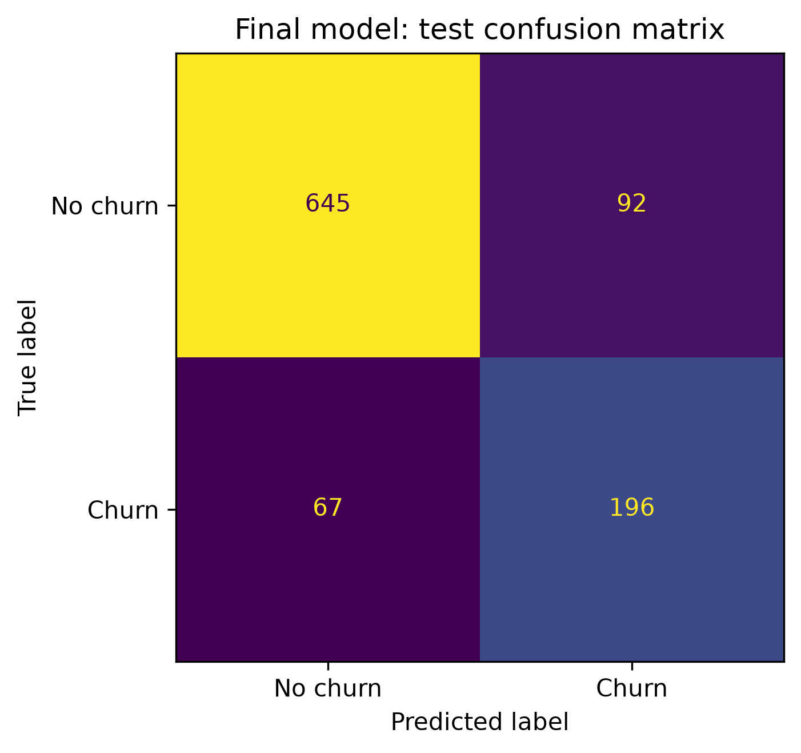

# Telecom Customer Churn Analysis

## Overview

This project analyzes customer service, billing, and usage data to predict customer churn. It compares five classification algorithms and examines the factors associated with the selected model’s predictions.

The project demonstrates a Python-based workflow for data preparation, feature engineering, model comparison, threshold selection, and interpretation.

## Project Objective

The objective is to identify customers at higher risk of leaving and evaluate the trade-off between missed churn cases and false alerts. The analysis focuses on classification performance; it does not measure the effect of a retention campaign.

## Skills Demonstrated

- Data Cleaning and Validation
- Exploratory Data Analysis (EDA)
- Feature Engineering
- Classification and Model Comparison
- Decision Threshold Selection
- Model Interpretation and Visualization

## Tools and Technologies

- Python 3.14
- pandas and NumPy
- scikit-learn
- XGBoost, CatBoost, and LightGBM
- Matplotlib, Seaborn, and SHAP
- JupyterLab and joblib

## Dataset

The analysis uses a supplied augmented telecom extract with 4,999 rows. It contains customer attributes, service details, billing information, support activity, and a `Churn` label.

The source CSV is not included. The `data/` directory retains [data instructions](data/README.md) and an unlabeled synthetic example. The standard IBM Telco dataset does not include the additional fields required here and is not a drop-in replacement. The augmented extract’s source, license, and field timing remain unverified.

## Key Analysis Performed

### Data Cleaning and Preparation

Standardized text, checked customer identifiers and missing values, and prepared numeric and categorical features.

### Feature Engineering

Created features describing support escalation, customer friction, service reliability, tenure, and monthly charges.

### Model Comparison

Compared Logistic Regression, Random Forest, XGBoost, CatBoost, and LightGBM. Preprocessing stays within training pipelines.

### Threshold Selection and Evaluation

Used five-fold out-of-fold predictions on development data to select the final model and F1 threshold. The original split is 40% training, 20% validation, 20% test, and 20% unused reserve.

### Model Interpretation

Examined coefficients and SHAP values to describe model associations. Individual-customer feature tables and explanations remain excluded from the public report.

## Results

The selected Logistic Regression model uses `C=1.0` and a decision threshold of `0.353`.

| Metric | Recorded test result |
| --- | ---: |
| Accuracy | 0.841 |
| Precision | 0.681 |
| Recall | 0.745 |
| F1 | 0.711 |
| ROC-AUC | 0.895 |
| Average precision | 0.793 |

These results describe the recorded test split. They do not establish performance on future customers or prove reduced churn. See the [saved test metrics](table/telco_churn_v2_final_test_metrics.csv).

## Example Visualizations

The project includes distribution plots, model comparisons, precision-recall and ROC curves, a confusion matrix, and aggregate feature-importance and SHAP plots. The [HTML report](Telco-Churn.html) provides a static view of the notebook.



## Installation

Clone the repository and create an environment using Python 3.14:

```bash
git clone https://github.com/staticbloom/customer-churn-analysis.git
cd customer-churn-analysis
python3.14 -m venv .venv
```

Activate the environment on macOS/Linux:

```bash
source .venv/bin/activate
```

On Windows, create the environment with `py -3.14 -m venv .venv` and activate it in PowerShell:

```powershell
.venv\Scripts\Activate.ps1
```

Install the recorded dependencies:

```bash
python -m pip install -r requirements.txt
python -m pip check
```

The version pins match the recorded project environment. Installation in a fresh environment has not been independently verified.

## Usage

### Score the synthetic example

```bash
python predict.py data/example_customers_synthetic.csv --output outputs/customer_predictions.csv
```

The saved model is included, so this example works without the source dataset. Use a new output filename for each run.

### Open the notebook

```bash
python -m jupyterlab notebooks/Telco-Churn.ipynb
```

The saved notebook can be read without the source CSV. Running all cells requires the matching augmented extract and retrains models, replacing generated outputs.

### Train or evaluate a separate candidate

```bash
python train.py new_customers.csv --output-dir runs/churn_candidate
python train.py new_customers.csv --evaluate-only --output-dir runs/churn_evaluation
```

New labeled data must follow the documented input contract. The separate trainer uses a 60/20/20 split and does not recreate the original study. Output directories must be new.

## Limitations and Reproducibility

- The timing and provenance of the augmented fields need verification before practical use.
- Random splitting does not test future-period generalization. Full-source EDA and repeated development comparisons limit independence claims.
- Coefficients and SHAP describe associations, not causal retention effects. Probability calibration and retention costs remain unverified.

See [technical notes](TECHNICAL_NOTES.md) for the complete input contract, detailed workflow, and reproduction limits. Model artifacts should only be loaded from trusted sources.

## Author

**Shiv Sharma**

Data Analyst working with Python, statistical analysis, data visualization, and machine learning.
